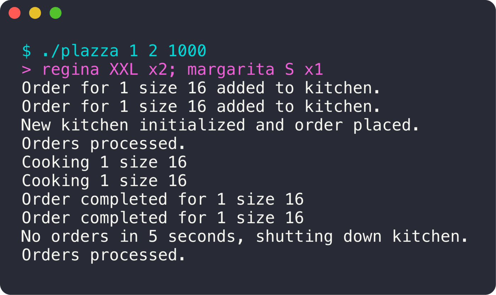

<div align="center">

# The Plazza

**Une pizzeria simulée avec des processus, des threads et des files de messages.**

   

<sub>Projet à 3 · 2024</sub>

</div>

<br/>

<p align="center"></p>

## Le projet en quelques mots

Une réception prend les commandes en ligne de commande et les envoie à des cuisines. Chaque cuisine est un **processus**, chaque cuisinier un **thread**. Quand toutes les cuisines sont pleines, on en ouvre une nouvelle, et quand une cuisine ne fait plus rien pendant 5 secondes, elle ferme.

## Ce que ça fait

- Prise de commandes interactive : `regina XXL x2; margarita S x1`
- **Une cuisine = un processus** (`fork`), créé à la demande selon la charge
- **Un cuisinier = un thread**, avec un stock d'ingrédients qui se régénère
- Communication réception ↔ cuisines par **files de messages** System V (`msgsnd` / `msgrcv`)
- Fermeture automatique des cuisines inactives
- Temps de cuisson et nombre de cuisiniers configurables

## Lancer le projet

```bash
make
./plazza <multiplicateur_cuisson> <cuisiniers_par_cuisine> <régénération_ms>
./plazza 1 2 1000
```

## L'équipe

<a href="https://github.com/Wilson-Epitech/plazza/graphs/contributors"></a>

Yassine Majdoul, Wilson Bordichon, Josué Ménager

**Ma partition :** J'ai mis en place la **communication entre processus** (files de messages entre la réception et les cuisines), la **création des cuisines** dans des processus fils, le parsing des commandes de la réception et la CI GitHub Actions.
